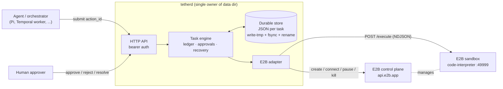
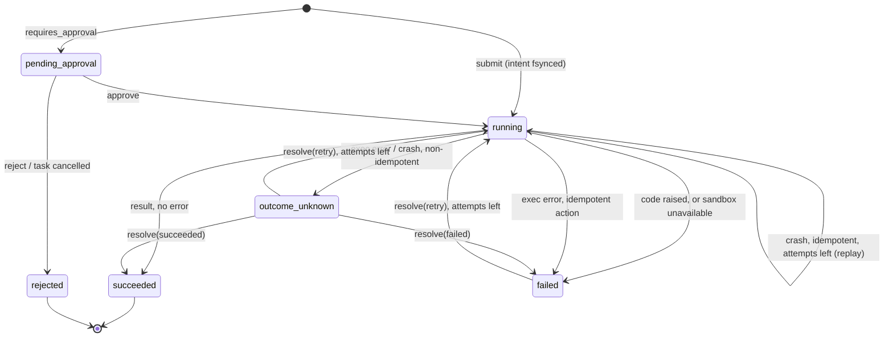
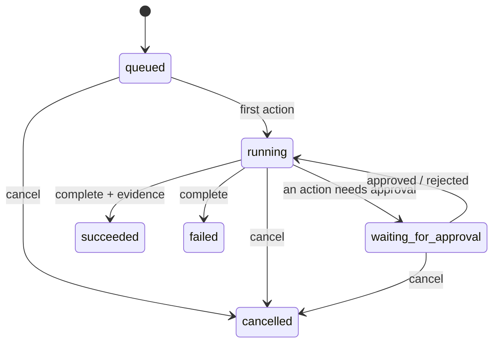
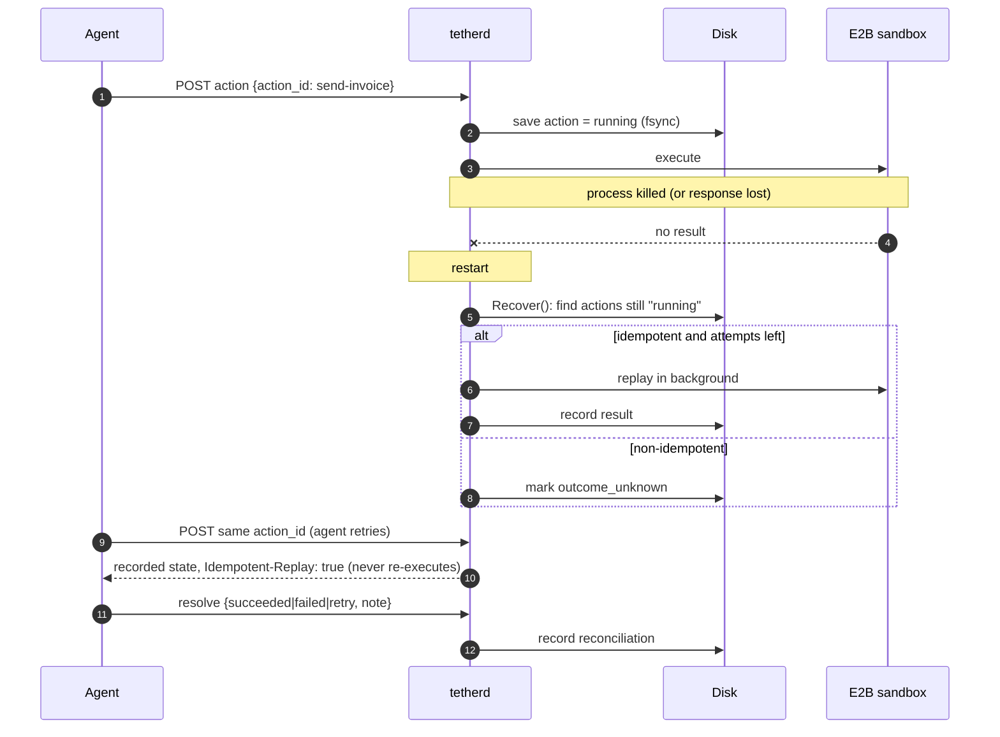
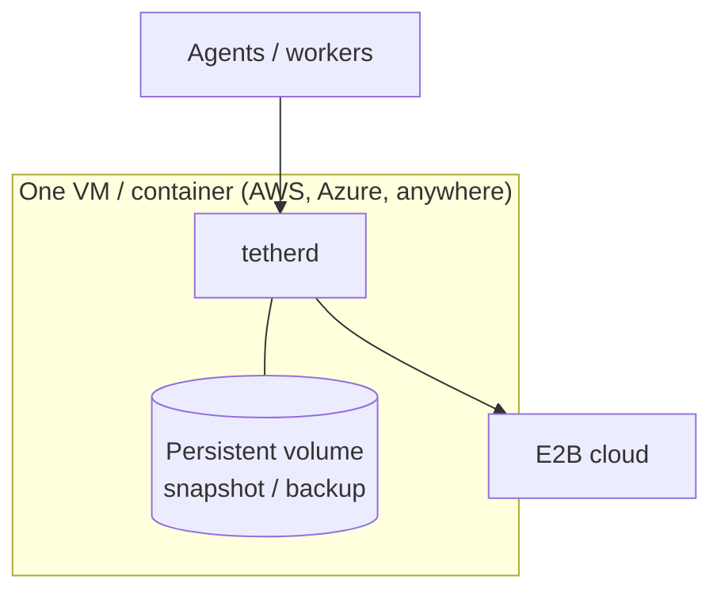

# Architecture

tether is deliberately small. E2B owns isolation and the sandbox lifecycle; the agent owns reasoning.
tether owns exactly one thing: **a durable record of what the agent asked the sandbox to do.**

## Components

## Action lifecycle

The intent is written to disk **before** the sandbox is called. That single ordering rule is what makes
crash recovery honest.

A task can only be completed when no action is `running`, `pending_approval` or `outcome_unknown`.

## Task lifecycle

## Crash recovery

## Where Pi fits

tether does not replace the agent runtime. Pi (or any agent) decides *what* to do and calls tether to do it
safely. Pi's own session persistence recovers the conversation; tether recovers the *side effects*.
Don't let two layers retry the same action: give the agent a stable `action_id` per intended effect and
let tether be the only place that decides whether it runs again.

## Scaling and deployment

tether is a single-node service by design (one process owns the data dir). That is enough for a first
production workload: E2B does the heavy, scalable part.

When you outgrow it: put a workflow engine (e.g. Temporal) in front for durable timers and long waits, and
swap `internal/store` for Postgres behind the same `Save/Load/IDs` surface. Keep tether (or its ledger
rules) as the layer that owns action dedupe and reconciliation.

## Out of scope (on purpose)

- Running Firecracker yourself (E2B does this).
- Per-user OAuth token injection. If sandboxed code needs third-party credentials, pass short-lived scoped
  tokens per task, or add an egress proxy as a separate component.
- Multi-node HA / active-active.
